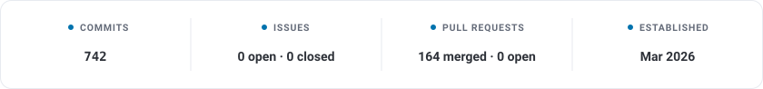

<!-- tailor:social-header:start -->
<p align="center">
  <a href="https://tailor.wimpys.world"><picture><source media="(prefers-color-scheme: dark)" srcset="https://raw.githubusercontent.com/wimpysworld/tailor/social-assets/hero-dark.svg"></picture></a>
</p>
<!-- tailor:social-header:end -->

<!-- tailor:social-links:start -->
<p align="center">
  <a href="https://bsky.app/profile/wimpys.world"><picture><source media="(prefers-color-scheme: dark)" srcset="https://raw.githubusercontent.com/wimpysworld/tailor/social-assets/link-bluesky-dark.svg"></picture></a>
  <a href="https://wimpysworld.social/@martin"><picture><source media="(prefers-color-scheme: dark)" srcset="https://raw.githubusercontent.com/wimpysworld/tailor/social-assets/link-mastodon-dark.svg"></picture></a>
  <a href="https://linkedin.com/in/martinwimpress"><picture><source media="(prefers-color-scheme: dark)" srcset="https://raw.githubusercontent.com/wimpysworld/tailor/social-assets/link-linkedin-dark.svg"></picture></a>
</p>
<!-- tailor:social-links:end -->

<!-- tailor:social-community:start -->
<p align="center">
  <a href="https://discord.com/invite/vUsydfP"><picture><source media="(prefers-color-scheme: dark)" srcset="https://raw.githubusercontent.com/wimpysworld/tailor/social-assets/community-dark.svg"></picture></a>
</p>
<!-- tailor:social-community:end -->

Tailor is a local terminal CLI that keeps GitHub repositories consistent with community health files, security policies, dev tooling, and repository settings.

Use it for solo projects or small teams that manage several repositories. Its embedded template files are called *swatches*.

## Features

- **Community health files**: security policy, code of conduct, contributing and support guides, issue and pull request templates, funding, Dependabot, and a licence fetched from GitHub.
- **[Repository settings](https://github.com/wimpysworld/tailor/wiki/Repository-settings)**: merge options, topics, workflow permissions, Dependabot alerts, secret scanning, push protection, and labels.
- **[Branch ruleset](https://github.com/wimpysworld/tailor/wiki/Ruleset)**: one managed ruleset for pull requests, status checks, and code scanning gates.
- **[GitHub Actions](https://github.com/wimpysworld/tailor/wiki/GitHub-Actions)**: Actions policy and repository variables.
- **[Code scanning and quality](https://github.com/wimpysworld/tailor/wiki/Code-scanning-and-quality)**: CodeQL default setup and GitHub Code Quality.
- **[Development tooling](https://github.com/wimpysworld/tailor/wiki/Configuration)**: Nix flake, direnv, and `just build`, `test`, and `lint` for Go, Rust, Python, Shell, and JavaScript or TypeScript.
- **[Go releases](https://github.com/wimpysworld/tailor/wiki/Configuration#go-support)**: GoReleaser archives, native packages, container images, and a builder workflow.
- **[GitHub Pages](https://github.com/wimpysworld/tailor/wiki/GitHub-Pages)**: a static starter site, or publication of an existing Hugo or Jekyll site.
- **[GitHub wiki](https://github.com/wimpysworld/tailor/wiki/GitHub-wiki)**: publish the wiki from `wiki/` in the repository.
- **Previews before changes**: `baste` shows every change before `alter` applies it. Tailor uses free GitHub features only.

<!-- tailor:social-stats:start -->
<p align="center">
  <a href="https://github.com/wimpysworld/tailor/pulse"><picture><source media="(prefers-color-scheme: dark)" srcset="https://raw.githubusercontent.com/wimpysworld/tailor/social-assets/stats-dark.svg"></picture></a>
</p>
<!-- tailor:social-stats:end -->

## Install

First-party signed package repositories are published for Linux, macOS, and Windows through [wimpys.world](https://wimpys.world/). Choose your platform below for setup instructions and automatic updates.

<!-- tailor:social-packages:start -->
<p align="center">
  <a href="https://apt.wimpys.world/#tailor"><picture><source media="(prefers-color-scheme: dark)" srcset="https://raw.githubusercontent.com/wimpysworld/tailor/social-assets/pkg-apt-dark.svg"></picture></a>
  <a href="https://rpm.wimpys.world/#tailor"><picture><source media="(prefers-color-scheme: dark)" srcset="https://raw.githubusercontent.com/wimpysworld/tailor/social-assets/pkg-rpm-dark.svg"></picture></a>
  <a href="https://pkg.wimpys.world/#tailor"><picture><source media="(prefers-color-scheme: dark)" srcset="https://raw.githubusercontent.com/wimpysworld/tailor/social-assets/pkg-pkg-dark.svg"></picture></a>
  <a href="https://apk.wimpys.world/#tailor"><picture><source media="(prefers-color-scheme: dark)" srcset="https://raw.githubusercontent.com/wimpysworld/tailor/social-assets/pkg-apk-dark.svg"></picture></a>
  <br>
  <a href="https://brew.wimpys.world/#tailor"><picture><source media="(prefers-color-scheme: dark)" srcset="https://raw.githubusercontent.com/wimpysworld/tailor/social-assets/pkg-brew-dark.svg"></picture></a>
  <a href="https://scoop.wimpys.world/#tailor"><picture><source media="(prefers-color-scheme: dark)" srcset="https://raw.githubusercontent.com/wimpysworld/tailor/social-assets/pkg-scoop-dark.svg"></picture></a>
  <a href="https://nix.wimpys.world/#tailor"><picture><source media="(prefers-color-scheme: dark)" srcset="https://raw.githubusercontent.com/wimpysworld/tailor/social-assets/pkg-nix-dark.svg"></picture></a>
</p>
<!-- tailor:social-packages:end -->

<details>
<summary><strong>Any platform (<code>bin</code>)</strong> - install and update the release binary directly</summary>

[bin](https://github.com/marcosnils/bin) installs and updates the release binary:

```shell
bin install github.com/wimpysworld/tailor
```

</details>

<details>
<summary><strong>Container (GHCR)</strong> - run <code>ghcr.io/wimpysworld/tailor</code> on <code>linux/amd64</code> and <code>linux/arm64</code></summary>

Images are published to GHCR for `linux/amd64` and `linux/arm64`. Mount your project directory and pass a GitHub token:

```shell
docker run --rm \
  --user "$(id -u):$(id -g)" \
  -v "$PWD":/work -w /work \
  -e GH_TOKEN \
  ghcr.io/wimpysworld/tailor alter
```

The `--user` option uses your host identity for Git ownership checks and writes to the mounted checkout.

</details>

<!-- tailor:social-sponsors:start -->
<p align="center">
  <a href="https://github.com/sponsors/flexiondotorg"><picture><source media="(prefers-color-scheme: dark)" srcset="https://raw.githubusercontent.com/wimpysworld/tailor/social-assets/sponsors-dark.svg"></picture></a>
</p>
<!-- tailor:social-sponsors:end -->

### Authentication

Tailor needs a valid GitHub authentication token for `fit`, `alter`, and `baste`. Set `GH_TOKEN` or `GITHUB_TOKEN` to use Tailor without the `gh` binary.

Alternatively, install the [GitHub CLI](https://cli.github.com/) and run `gh auth login`. Tailor can then read the token from the `gh` config file or keyring. The `measure` and `docket` commands do not require authentication.

## Quick start

`fit` writes `.tailor.yml` without copying swatches or changing repository settings. The default licence is BlueOak-1.0.0.

### New project

Create the project and enter its directory:

```bash
tailor fit ./my-project
cd my-project
```

### Existing project

Check local health files, then create the configuration:

```bash
cd existing-project
tailor measure
tailor fit .
```

If `.tailor.yml` already exists, skip `fit`. With a GitHub remote, `fit` imports only the repository's `description` and `homepage`. All other managed settings come from Tailor's embedded defaults.

### Review and apply

For either project, edit `.tailor.yml` to choose the licence, repository settings and files that Tailor manages. Set a swatch to `alteration: never` to leave its file untouched.

Repository settings require a GitHub remote. For a new local project, add its GitHub remote before the preview.

Preview the changes without writes:

```bash
tailor baste
```

After you review the preview, apply the changes:

```bash
tailor alter
```

<!-- tailor:social-demo:start -->
<p align="center">
  <picture><source media="(prefers-color-scheme: dark)" srcset="https://raw.githubusercontent.com/wimpysworld/tailor/social-assets/demo-dark.svg"></picture>
</p>
<!-- tailor:social-demo:end -->

> [!IMPORTANT]
> Most swatches with `alteration: always` replace local file edits. Ordinary `.gitignore` processing preserves an existing file or final symlink. Enabled Hugo or Jekyll Pages can append its output rule later. Review the preview before each `alter` run.

### Upgrade an existing project

1. Upgrade the `tailor` binary.
2. Run `tailor measure` to compare `.tailor.yml` with the new defaults. Remove each `config-only` entry, because `alter` rejects it.
3. Run `tailor baste --verbose` to preview the changes.
4. Declare new opt-in features in `.tailor.yml`. Default merging never turns on `languages`, `pages`, `mcp`, or the wiki.
5. Run `tailor baste` again to preview the new features.
6. Run `tailor alter`.
7. Make the manual edits that the output lists under `Next`. Tailor preserves an existing `justfile` and `flake.nix`.

[Default merging](https://github.com/wimpysworld/tailor/wiki/Configuration#default-merging) adds missing defaults to `.tailor.yml` only when its swatch entry is `always`, or `first-fit` with `--recut`.

## Agent skill

The repository includes a skill at [`skills/tailor/SKILL.md`](skills/tailor/SKILL.md). It helps an agent fit, baste, alter, and upgrade a project. Copy the `skills/tailor/` directory into your agent's skills directory.

## Development

Enter the pinned shell with `nix develop`. Use `just build` to build executables, including Tailor's stripped root binary. Use `just test` for full vet and tests with console coverage. Use `just lint` for read-only checks. Use `just lint correct` explicitly to tidy modules and format source before the checks. Go checks can download modules and vulnerability data. See the [Go configuration guide](https://github.com/wimpysworld/tailor/wiki/Configuration#shared-go-policy) for policy and project scripts.

## Documentation

Read the [wiki](https://github.com/wimpysworld/tailor/wiki) for detailed guides and reference material.

## Support and contributing

Read [Support](SUPPORT.md) for help and [Contributing](CONTRIBUTING.md) before submitting a change. The [specification](docs/SPECIFICATION.md) defines Tailor's behaviour.

<!-- tailor:social-stars:start -->
<p align="center">
  <a href="https://github.com/wimpysworld/tailor"><picture><source media="(prefers-color-scheme: dark)" srcset="https://raw.githubusercontent.com/wimpysworld/tailor/social-assets/stars-dark.svg"></picture></a>
</p>
<!-- tailor:social-stars:end -->

<!-- tailor:social-contributors:start -->
<p align="center">
  <a href="https://github.com/wimpysworld/tailor/graphs/contributors"><picture><source media="(prefers-color-scheme: dark)" srcset="https://raw.githubusercontent.com/wimpysworld/tailor/social-assets/contributors-dark.svg"></picture></a>
</p>
<!-- tailor:social-contributors:end -->

<!-- tailor:social-footer:start -->
<p align="center">
  <a href="https://tailor.wimpys.world"><picture><source media="(prefers-color-scheme: dark)" srcset="https://raw.githubusercontent.com/wimpysworld/tailor/social-assets/footer-dark.svg"></picture></a>
</p>
<!-- tailor:social-footer:end -->
